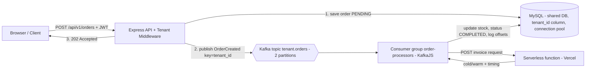

# CSC337 Lab 06 - Multi-Tenant B2B SaaS with Kafka, DB Tuning and Serverless Worker

**Student:** Muniba Ishfaq | **Reg #:** SP24-BSE-024 | **Course:** CSC337 Advanced Web Technologies

A multi-tenant order platform. Two companies (Acme Traders, Globex Pharma) share one MySQL database but can never see each other's data. Orders are accepted instantly (`202 Accepted`), pushed to Apache Kafka, and processed in the background. Invoices are generated by a serverless function.


## Links

| What | URL |
|---|---|
| Live app (frontend + API) | https://YOUR-APP.up.railway.app |
| Serverless invoice function | https://lab06-invoice.vercel.app/api/invoice |
| Kafka | Aiven for Apache Kafka (free tier), topic `tenant.orders` |
| GitHub | https://github.com/Muniba-ishfaq33/csc337-lab06-saas |

## Test accounts

| Tenant | `x-tenant-id` | Email | Password |
|---|---|---|---|
| Tenant A - Acme Traders | `acme` | admin@acme.com | Acme@123 |
| Tenant B - Globex Pharma | `globex` | admin@globex.com | Globex@123 |

## Architecture



Plain-text version (in case your viewer does not render mermaid):

```
Client --> API Gateway (Express + tenant middleware) --> MySQL (pool)
                          |
                          +--> Kafka topic "tenant.orders" (key = tenant_id)
                                     |
                                     v
                         Consumer group "order-processors"
                           |-> MySQL: stock-1, status COMPLETED, offset log
                           |-> Vercel serverless: invoice PDF (cold vs warm timing)
```

### How the requirements are met

| Requirement | Where |
|---|---|
| Multi-tenancy (shared DB + `tenant_id`) | `sql/schema.sql`, every table has `tenant_id` |
| Tenant resolution middleware (JWT claim, `x-tenant-id`, subdomain) | `src/middleware/tenant.js` |
| Tenant data boundary | `src/repo.js` - `forTenant(id)` hard-wires `tenant_id = ?` into every query; routes cannot query without it |
| N+1 problem and fix | `ordersWithItemsNPlusOne` vs `ordersWithItemsJoin` in `src/repo.js` |
| EXPLAIN ANALYZE before/after composite index | `npm run benchmark`, output in `BENCHMARK_RESULTS.md` |
| Connection pooling | `src/config/db.js` (mysql2 pool, limit 10, queueing) |
| Kafka producer, 202 Accepted, key = `tenant_id` | `src/producer.js`, `src/routes/api.js` |
| Consumer group with offset logging | `src/consumer.js`, table `processed_events` |
| Serverless worker + cold start | `serverless/api/invoice.js`, table `invoice_log` |

## Screenshots

### 1. Placing an order (202 Accepted)

The API replies immediately with `202 Accepted`. The response contains the Kafka topic, partition and offset. The order starts as `PENDING` and becomes `COMPLETED` once the consumer processes it.


### 2. Consumer processing the event

Consumer terminal output for each order (partition, offset, outcome):


### 3. EXPLAIN ANALYZE before and after the composite index

**Before index (164 ms)** - MySQL has to run a `Sort` step over about 50,000 rows:


**After index (0.6 ms)** - the `Sort` step is gone, MySQL reads the index backwards:


### 4. Benchmark summary


### 5. Cold vs warm start (dashboard card)


## Benchmark results

Run `npm run benchmark`. It drops the composite index, runs `EXPLAIN ANALYZE`, creates the index, runs it again, then compares N+1 against JOIN. Full output is in [`BENCHMARK_RESULTS.md`](BENCHMARK_RESULTS.md).

| Metric | Before index | After index |
|---|---|---|
| EXPLAIN ANALYZE execution time | 164.248 ms | 0.618 ms |
| Average latency over 15 runs | 162.19 ms | 0.9 ms |
| Median | 159.76 ms | 0.86 ms |
| Min / Max | 149.92 / 185.43 ms | 0.71 / 1.14 ms |
| Plan | Index lookup on tenant + `Sort` | Index lookup on `idx_orders_tenant_created` (backwards), no Sort |

| Strategy | SQL queries | Avg time |
|---|---|---|
| N+1 (one query per order) | 101 | 67.93 ms |
| JOIN (single query) | 1 | 4.67 ms |

**Why the index helps:** without it MySQL finds the tenant's rows and then has to sort them all by `created_at` just to return 50. The composite index `(tenant_id, created_at)` is already sorted by tenant and then by time, so MySQL reads the newest 50 entries and stops.

**Why JOIN beats N+1:** N+1 sends 1 query for the orders and then 1 more per order (101 round trips for 100 orders). The JOIN version sends one.

### Cold start vs warm start report

The function was left idle for 10-15 minutes, then called once (cold), then 4-5 times quickly (warm). Numbers come from the dashboard card or `/api/v1/invoices/stats`.

| Start type | Calls | Avg function ms | Avg round-trip ms |
|---|---|---|---|
| cold | _(fill)_ | _(fill)_ | _(fill)_ |
| warm | _(fill)_ | _(fill)_ | _(fill)_ |

How it is detected: a variable outside the handler (`isCold = true`) is set once when Vercel boots a new container, so only the first request in that container sees `true`. "Function ms" is the time inside the handler; "round-trip ms" also includes network and container boot, which is where the cold-start penalty shows up.

## Run it locally (Windows + Laragon + VS Code)

**Needs:** Node 18+, Laragon (MySQL 8.0.18 or newer, because `EXPLAIN ANALYZE` needs it), and either Docker Desktop (local Kafka) or a free Aiven Kafka account.

```bash
# 1. install packages
npm install

# 2. config
copy .env.example .env        # then open .env and check DB_PASSWORD (Laragon default is empty)

# 3. start MySQL in Laragon, then create tables and seed data
npm run db:init
npm run seed                  # ~100,000 orders across 2 tenants

# 4. start Kafka (pick ONE)
docker compose up -d          # local Redpanda on localhost:9092
#    OR fill KAFKA_* in .env with your Aiven details (see below)

# 5. run API and consumer in two separate terminals
npm start                     # terminal 1  -> http://localhost:3000
npm run consumer              # terminal 2  -> shows partition/offset for every order

# 6. prove tenant isolation
npm run test:isolation
```

Open http://localhost:3000, log in as Acme or Globex, place an order, and watch terminal 2.

### Using Aiven Kafka (free) instead of Docker
1. Sign up at aiven.io, click **Create service**, choose **Apache Kafka**, pick the **Free** plan.
2. Wait until the service is **Running**. On the Overview page copy the **Service URI** (host:port) and download **ca.pem** into a `certs/` folder.
3. In the **Topics** tab create topic `tenant.orders` with **2 partitions**.
4. Fill `.env` (SASL authentication):
```
KAFKA_BROKERS=your-service-host.aivencloud.com:12345
KAFKA_USERNAME=avnadmin
KAFKA_PASSWORD=your-aiven-password
KAFKA_SASL_MECHANISM=scram-sha-256
KAFKA_SSL_CA_PATH=certs/ca.pem
KAFKA_TOPIC=tenant.orders
KAFKA_PARTITIONS=2
```
Alternative (client certificate): leave `KAFKA_USERNAME` and `KAFKA_PASSWORD` empty and set `KAFKA_SSL_CERT_PATH=certs/service.cert` and `KAFKA_SSL_KEY_PATH=certs/service.key`.

Note: the free service switches itself off when idle. Power it on from the Aiven console before testing or the viva.

## API quick reference

All routes except login need `Authorization: Bearer <token>`. Login needs `x-tenant-id`.

| Method | Route | Notes |
|---|---|---|
| POST | `/api/v1/auth/login` | body `{email, password}` + header `x-tenant-id: acme` |
| GET | `/api/v1/products` | this tenant's products |
| GET | `/api/v1/orders?limit=20` | orders + items using one JOIN |
| GET | `/api/v1/orders/:id` | 404 if the order belongs to another tenant |
| POST | `/api/v1/orders` | body `{items:[{product_id, quantity}]}` -> **202 Accepted** |
| GET | `/api/v1/events` | consumer log (partition, offset, outcome) |
| GET | `/api/v1/invoices/stats` | cold vs warm averages |
| GET | `/api/v1/benchmark/compare` | N+1 vs JOIN timing |
| GET | `/api/v1/benchmark/explain` | live EXPLAIN ANALYZE |
| POST | `/api/v1/benchmark/index` | `{action:"drop"}` or `{action:"create"}` (admin) |
| GET | `/api/v1/health` | DB check + connection pool stats |

## Deployment

### 1. Serverless invoice function (Vercel)
```bash
cd serverless
npm install
npx vercel
npx vercel env add INVOICE_SECRET production
npx vercel --prod
```
`INVOICE_SECRET` must be the same value as in the main app. If the URL shows a Vercel login page, disable **Deployment Protection > Vercel Authentication** in the project settings. Opening `/api/invoice` in a browser (GET) gives a quick demo response; add `?download=1` to download a sample PDF.

### 2. API + frontend + MySQL (Railway)
1. Push the repo to GitHub.
2. On railway.com: **New Project > Deploy from GitHub repo**, then **+ New > Database > Add MySQL**.
3. In the app service **Variables**, set:
```
JWT_SECRET=<long random text>
DB_HOST=${{MySQL.MYSQLHOST}}
DB_PORT=${{MySQL.MYSQLPORT}}
DB_USER=${{MySQL.MYSQLUSER}}
DB_PASSWORD=${{MySQL.MYSQLPASSWORD}}
DB_NAME=${{MySQL.MYSQLDATABASE}}
KAFKA_BROKERS=<aiven host:port>
KAFKA_TOPIC=tenant.orders
KAFKA_PARTITIONS=2
KAFKA_USERNAME=avnadmin
KAFKA_PASSWORD=<aiven password>
KAFKA_SASL_MECHANISM=scram-sha-256
KAFKA_SSL_CA=<ca.pem as one line with \n>
RUN_CONSUMER_IN_API=true
INVOICE_FUNCTION_URL=https://lab06-invoice.vercel.app/api/invoice
INVOICE_SECRET=<same as Vercel>
```
4. **Settings > Networking > Generate Domain** to get the live URL.
5. Create tables and seed the cloud DB from your PC (using the MySQL public host/port):
```powershell
$env:DB_HOST="xxxx.proxy.rlwy.net"; $env:DB_PORT="12345"
$env:DB_USER="root"; $env:DB_PASSWORD="..."; $env:DB_NAME="railway"
$env:SEED_ORDERS_PER_TENANT="20000"
npm run db:init
npm run seed
```

`RUN_CONSUMER_IN_API=true` runs the Kafka consumer inside the same process as the API, so one service is enough. The frontend (`public/`) is served by the same Express app, so the Railway URL is both frontend and backend.

## Viva cheat sheet

1. **Trigger an event live:** log in on the dashboard, click *Place order*. Show the `202` JSON (it contains partition and offset).
2. **Show consumer offsets:** the consumer prints `partition=1 offset=17 key=1 -> acme order #50123: COMPLETED`. On Aiven this terminal output (or the Consumer log card) is the proof.
3. **Ordering proof:** place 3 orders as Acme: same `key`, same partition, rising offsets. Globex orders may land in another partition.
4. **Run EXPLAIN ANALYZE live:** dashboard -> *Drop index* -> *EXPLAIN ANALYZE* (Sort appears) -> *Create index* -> *EXPLAIN ANALYZE* (Sort gone).
5. **N+1 live:** dashboard -> *N+1 vs JOIN*. Point at `queries: 101` versus `queries: 1`.
6. **Isolation:** `npm run test:isolation`, or log in as Globex and open Acme's order id (gives 404).
7. **Failure case:** order 999999 of one product: consumer marks it `FAILED: not enough stock` and rolls back.

## Design notes

- **Why shared DB + tenant_id?** Cheapest to run and easiest to scale to many tenants. The risk is a forgotten `WHERE tenant_id`, which is why all queries live in `forTenant()`.
- **Why key = tenant_id?** Same key -> same partition -> events of one tenant are processed in order.
- **Idempotency:** each event has a UUID stored in `processed_events`, and the order row is locked (`FOR UPDATE`) and only processed while `PENDING`, so a re-delivered message cannot subtract stock twice.
- **Why 202?** The client does not wait for stock updates or invoices. The work continues in the background.
- **Connection pool:** 10 reusable connections. Extra requests queue instead of opening new connections. `/api/v1/health` shows pool stats.

## Folder structure

```
docs/           screenshots used in this README
src/config      db.js (pool), kafka.js
src/middleware  tenant.js (resolution + auth guards)
src/routes      auth.js, api.js
src/repo.js     tenant-scoped data access (N+1 and JOIN versions live here)
src/producer.js Kafka producer      src/consumer.js Kafka consumer
scripts         init-db, seed, benchmark, isolation-test
serverless      Vercel invoice function (separate deploy)
public          Bootstrap dashboard
sql/schema.sql  tables
```